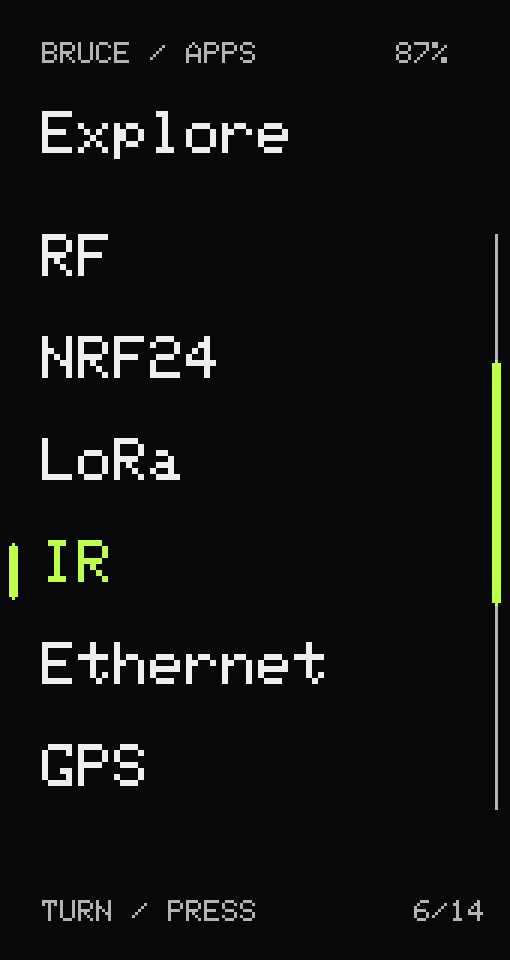

# Bruce Niagara UI

Niagara-inspired portrait menus for **Lilygo T-Embed CC1101**, based on [Bruce 1.15](https://github.com/BruceDevices/firmware/tree/1.15).

**[Install from your browser — Web Flasher](https://atlasru.github.io/Bruce-Niagara/)** · [Installer source and build instructions](webflasher/README.md)

This community fork keeps Bruce's functionality and adds a compact vertical launcher with the encoder below the screen. The original project is [BruceDevices/firmware](https://github.com/BruceDevices/firmware); upstream authorship and the AGPL-3.0 license are preserved.

<p align="center"></p>

*Layout illustration with the example lime palette. Colors are configurable; this is not a photograph of the device.*

## What changes

- Portrait layout for the 170 × 320 display, with the wheel below the screen.
- One-column launcher, submenus and file picker, a position rail, and scrolling long names.
- UI Color and imported theme palettes apply to the launcher, including custom-color previews.
- Portrait direction survives reboot. Orientation settings offer wheel below/above.
- Encoder handling is unchanged from Bruce 1.15, including its debounce and stale-step handling.
- A separate PlatformIO target keeps the UI changes scoped to this build.

**Status:** built, flashed and checked on a T-Embed CC1101. Portrait direction, navigation, UI Color and UI Theme were confirmed on hardware. Other boards have not been tested. Individual app screens and keyboards still use their upstream layouts; favorites and alphabetical jumping are not implemented yet.

## Download and install

Get the binaries from [Releases](https://github.com/atlasru/Bruce-Niagara/releases).

| Image | Offset | Purpose |
| --- | --- | --- |
| `Bruce-Niagara-v0.1.0-TEmbed-CC1101-app.bin` | `0x10000` | App-only update for Bruce 1.15 with the matching 16 MB partition layout; this is the tested installation path. |
| `Bruce-Niagara-v0.1.0-TEmbed-CC1101-full.bin` | `0x0` | Merged bootloader, partition table and application for a full installation or recovery. |

Back up your flash before changing firmware. The app-only image preserves the existing bootloader, partition table, NVS and filesystem. The full image covers the NVS region and can reset settings.

For the tested app-only update, enter the board's download mode and replace `COM3` with your serial port:

```sh
python -m pip install esptool==4.8.1
python -m esptool --chip esp32s3 --port COM3 --baud 230400 write_flash 0x10000 Bruce-Niagara-v0.1.0-TEmbed-CC1101-app.bin
```

The partition layout is `nvs @ 0x9000`, `app0 @ 0x10000` (size `0x470000`), `spiffs @ 0x480000`, and `coredump @ 0xff0000`. Check your layout before using the app-only update. Release assets include SHA-256 checksums. After flashing, exit download mode and power/restart the board normally.

## Build

```sh
git clone --branch niagara-ui https://github.com/atlasru/Bruce-Niagara.git
cd Bruce-Niagara
python -m pip install platformio==6.2.0
python -m platformio run -e lilygo-t-embed-cc1101-niagara
```

The build downloads the ESP32 toolchain and libraries. It compresses embedded web assets locally, so no online minification service is required. FastLED is pinned to 3.10.3 for compatibility with Bruce's board macros.

Outputs:

- `.pio/build/lilygo-t-embed-cc1101-niagara/firmware.bin` — app-only image.
- `Bruce-lilygo-t-embed-cc1101-niagara.bin` — merged image.

The existing generated MicroQuickJS headers can be used when no native host compiler is available. If you change the interpreter bindings, follow the host-compiler instructions from the build script or use the upstream Docker build environment.

See [implementation details](docs/niagara/README.md) and the preserved [upstream documentation](README.upstream.md).

## Example palette

Copy [niagara-lime.json](docs/niagara/niagara-lime.json) to SD or LittleFS, then select it through **Config → Display & UI → UI Theme**. The launcher uses primary, secondary and background colors, plus theme border/heading preferences. Category-image artwork is not used by the text launcher.

## Credits and license

Built on [Bruce](https://github.com/BruceDevices/firmware) and its contributors. The vertical text launcher is inspired by Niagara Launcher. This fork is independently maintained and is not an official release of either project.

[GNU Affero General Public License v3.0](LICENSE), as inherited from Bruce. See [upstream acknowledgements](README.upstream.md#clap-acknowledgements) and [third-party notices](THIRD_PARTY.md).
